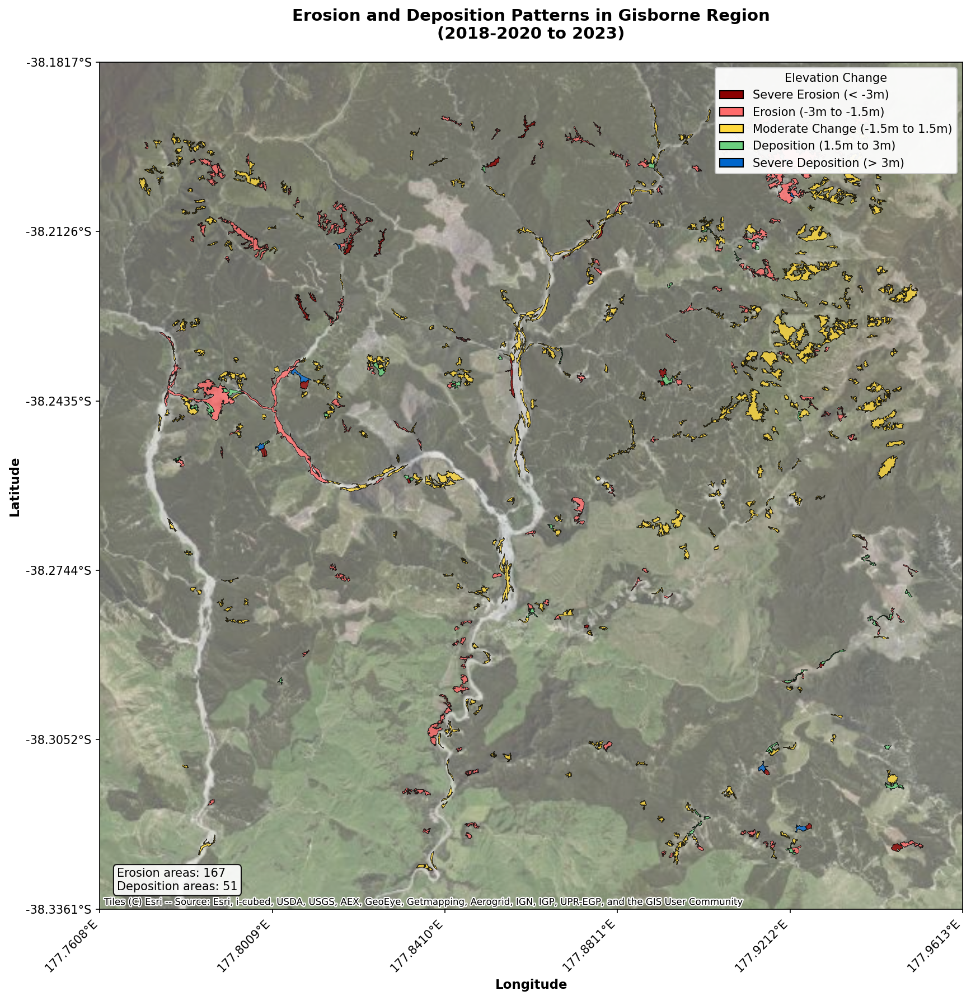
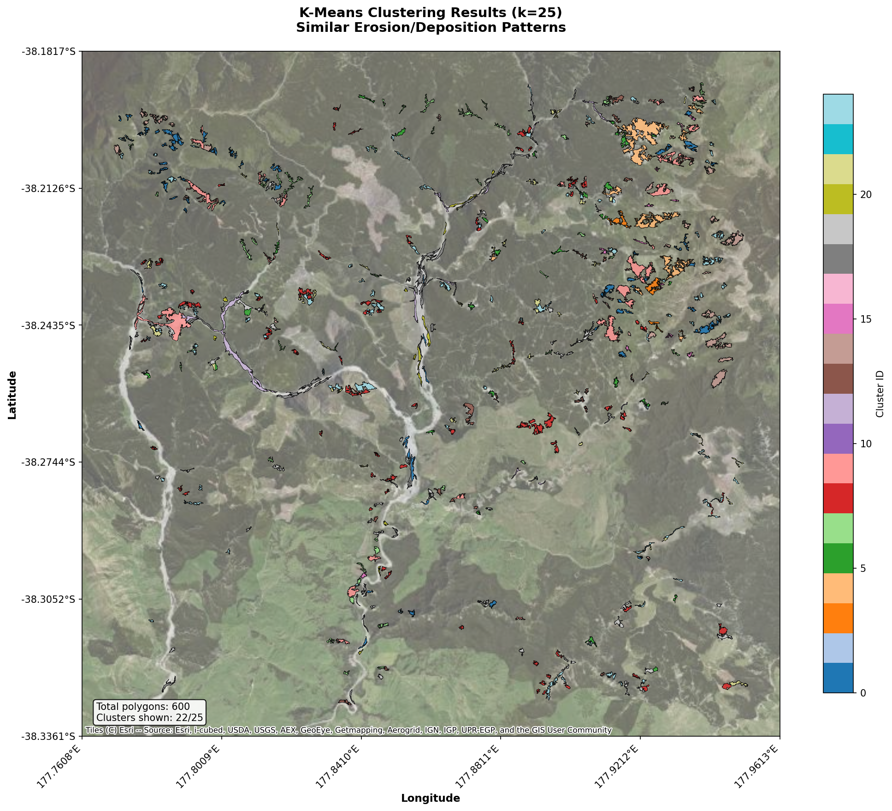

# Rivers - Erosion and Sedimentation Analysis for Gisborne, New Zealand

[](https://github.com/UoA-eResearch/rivers/actions/workflows/process-data.yml)

This repository contains code and data for analyzing erosion and sedimentation patterns in the Gisborne region of New Zealand using Digital Elevation Model (DEM) data from 2018-2020 and 2023, along with NDVI (Normalized Difference Vegetation Index) satellite imagery.

## Table of Contents

- [Overview](#overview)
- [Repository Structure](#repository-structure)
- [How It Works](#how-it-works)
- [Installation](#installation)
- [Usage](#usage)
- [Data Schema](#data-schema)
- [Methods and Limitations](#methods-and-limitations)
- [Visualizations](#visualizations)
- [Future Enhancements](#future-enhancements)
- [Data Sources](#data-sources)
- [References](#references)
- [License](#license)
- [Contributing](#contributing)
- [Citation](#citation)
- [Contact](#contact)

## Overview

The analysis identifies areas where the elevation changed by more than about half a metre (erosion or deposition) between the 2018-2020 and 2023 LiDAR DEMs, and characterizes these areas using:

- **Terrain attributes**: slope, aspect, curvature, profile and planform curvature, roughness, ruggedness, rugosity
- **Hydrological indices** (WhiteboxTools): downslope distance to stream, elevation above stream, depth to water, topographic wetness index (TWI), stream power index (SPI)
- **Sediment connectivity**: Borselli et al. (2008) index of connectivity, weighted by slope and land cover
- **Vegetation indices**: NDVI in 2018 and 2023, and the change between them
- **Land cover data**: LCDB (Land Cover Database) 2018 class of each polygon
- **River polygons**: change polygons are split at river polygon boundaries BEFORE feature extraction
- **Clustering**: weighted k-means clustering to identify similar erosion/deposition patterns

## Repository Structure

```
.
├── data/                           # Data files (large files tracked via Git LFS)
│   ├── NDVI_2018.tif              # NDVI raster for 2018
│   ├── NDVI_2023.tif              # NDVI raster for 2023
│   ├── REC2_geodata_version_5.zip # River Environment Classification data
│   ├── lris-lcdb-v50-*.zip        # Land Cover Database
│   ├── lds-nz-river-polygons-*.zip # NZ river polygons
│   ├── areas.parquet              # Elevation change polygons with features
│   └── clusters.parquet           # Clustered results
├── src/                            # Python source code
│   ├── batch.py                   # Main processing pipeline
│   ├── download_NDVI.py           # Script to download NDVI data from Google Earth Engine
│   └── create_example_visualizations.py # Generates the README example maps
├── notebooks/                      # Jupyter notebooks
│   ├── EDA.ipynb                  # Exploratory data analysis
│   └── clustering.ipynb           # Weighted k-means clustering and visualization
├── .github/workflows/             # GitHub Actions
│   └── process-data.yml           # Automated processing workflow
├── requirements.txt               # Python dependencies
└── README.md                      # This file
```

Running the pipeline also creates `prepared/` (tile index and study-area extracts of the reference data), `tile_results/` (one parquet file per DEM tile) and `data/areas+NDVI.parquet`; these are not committed.

## How It Works

### 1. Data Processing Pipeline (`src/batch.py`)

The pipeline has three stages, which run in sequence by default:

1. **Prepare** (`--stage prepare`)
   - Reads the header of every DEM tile of both epochs from the LINZ AWS S3 bucket, and writes a tile index and a GDAL VRT mosaic per epoch
   - Extracts REC2 river lines, LCDB land cover and LINZ river polygons for the study area into `prepared/`

2. **Tiles** (`--stage tiles`): for each of the 305 DEM tiles
   - Reads the 2018-2020 and 2023 DEMs (NoData handled as missing, so gaps in one epoch are not mistaken for change) and computes the elevation difference
   - Finds areas where the difference, rounded to the nearest metre, is non-zero (i.e. |Δz| > 0.5 m), sieved to at least 4000 m²
   - **Splits the polygons at river polygon boundaries FIRST**, keeping both the parts inside and outside the river (`in_river`) and dropping parts under 4000 m²
   - Computes hydrological indices with WhiteboxTools on the 2018-2020 (pre-change) DEM, including 500 m of the neighbouring tiles so flow paths are not cut off at tile edges (see [Methods](#methods-and-limitations)):
     - DownslopeDistanceToStream: distance along the flow path to the nearest stream
     - ElevationAboveStreamEuclidean: height above the nearest stream cell
     - Depth to water (Murphy et al. 2009 cartographic DTW)
     - WetnessIndex (TWI) and StreamPowerIndex (SPI)
     - Borselli index of connectivity
   - Computes terrain attributes (xdem) for the old DEM, new DEM and their difference
   - Summarises every raster over each polygon (min, max, mean, median, std), and adds the distance to the nearest REC2 stream and the dominant LCDB land-cover class

3. **Finalize** (`--stage finalize`)
   - Joins the tile results into `data/areas.parquet`
   - Adds NDVI statistics for 2018, 2023 and their difference, saved as `data/areas+NDVI.parquet`

### 2. Clustering Analysis (`notebooks/clustering.ipynb`)

The clustering notebook:
- Loads the processed data with NDVI features
- Groups the features by the variable they describe (e.g. the 15 slope statistics, the 5 TWI statistics, distance to river) and weights them so every variable contributes equally to the k-means distance, regardless of how many columns describe it (weights can be changed with `GROUP_WEIGHTS`)
- One-hot encodes the LCDB land-cover class, and log-transforms the heavily skewed polygon area and SPI
- Performs K-means clustering (k=25)
- Visualizes results on interactive maps
- Exports clustered data to GeoPackage for GIS software

## Installation

### Prerequisites

- Python 3.11 or higher
- pip package manager
- (Optional) Google Earth Engine account for downloading NDVI data

### Setup

1. Clone this repository:
```bash
git clone https://github.com/UoA-eResearch/rivers.git
cd rivers
```

2. Install dependencies:
```bash
pip install -r requirements.txt
```

3. Fetch the data files tracked with Git LFS (or download them from the sources below into `data/`):
```bash
git lfs pull
```

WhiteboxTools downloads its binary automatically the first time it is used.

## Usage

### Running the Batch Processing

Process all DEM tiles and extract features:

```bash
python src/batch.py
```

This will:
- Prepare the tile index and reference data (if `prepared/` doesn't exist)
- Process the 305 DEM tiles from the Gisborne region, saving progress to `tile_results/` (rerunning skips tiles that are already done; delete `tile_results/` to recompute them)
- Save results to `data/areas.parquet` and `data/areas+NDVI.parquet`

If `data/areas.parquet` already exists, only the NDVI step is run; use `--force-rebuild` to rebuild it from the tiles.

Each tile takes about 5 minutes and peaks at about 6 GB of memory, so the whole region takes roughly a day on one machine. The tile stage can be split over several machines:

```bash
python src/batch.py --stage prepare
```

```bash
python src/batch.py --stage tiles --shard 0 --num-shards 30
```

```bash
python src/batch.py --stage finalize --force-rebuild
```

To process particular tiles, use `--tiles BD44_10000_0503 ...`; add `--keep-intermediate` to keep the WhiteboxTools rasters in `wbt_outputs/`.

### Running the Clustering Analysis

Execute the clustering notebook:

```bash
cd notebooks
jupyter notebook clustering.ipynb
```

Or run it from the command line:

```bash
jupyter nbconvert --to notebook --execute --inplace notebooks/clustering.ipynb
```

This will:
- Load the processed data
- Perform weighted K-means clustering
- Generate visualizations
- Save clustered results to `data/clusters.parquet` and `data/clusters.gpkg`

### Automated Processing with GitHub Actions

The repository includes a GitHub Actions workflow that runs the whole pipeline monthly (or when triggered manually):
- **prepare**: checks out the REC2, LCDB and river polygon archives from LFS and extracts the study area
- **tiles**: 30 parallel jobs each process a share of the DEM tiles (a single job would exceed GitHub's 6 hour limit)
- **finalize**: joins the tiles, adds NDVI, runs the clustering notebook, and commits `data/areas.parquet`, `data/clusters.parquet`, `notebooks/clustering.ipynb` and `clustering.html` back to the repository

If a tile fails, its job is marked as failed and nothing is committed; use "Re-run failed jobs" to retry it, after which the finalize job runs. With the `load_areas_from_file` option the tile jobs are skipped and the existing `data/areas.parquet` is used.

To trigger manually:
1. Go to the "Actions" tab in GitHub
2. Select "Process Rivers Data"
3. Click "Run workflow"

## Data Schema

### Features Extracted

For each erosion/deposition polygon, the following features are extracted. Unless stated otherwise, each raster is summarised over the polygon by its `min`, `max`, `mean`, `median` and `std`.

**Elevation Statistics** (`old_*`, `new_*`, `diff_*`): elevation in 2018-2020, in 2023, and the change (m)

**Terrain Attributes** (`old_*`, `new_*`, `diff_*`, computed with xdem):
- `roughness_*`: Surface roughness
- `slope_*`: Terrain slope (degrees)
- `aspect_*`: Slope direction (degrees)
- `curvature_*`: Surface curvature
- `terrain_ruggedness_index_*`: TRI measure
- `rugosity_*`: Surface complexity
- `profile_curvature_*`: Curvature in slope direction
- `planform_curvature_*`: Curvature perpendicular to slope

**Hydrological Indices** (2018-2020 DEM):
- `downslope_dist_*`: Distance along the flow path to the nearest stream (m)
- `elevation_above_stream_*`: Height above the nearest (Euclidean distance) stream cell (m)
- `depth_to_water_*`: Cartographic depth to water (m)
- `twi_*`: Topographic wetness index, ln(SCA / tan(slope))
- `spi_*`: Stream power index, SCA × tan(slope)
- `connectivity_index_*`: Borselli index of sediment connectivity (log10, higher = better connected to streams)

**NDVI Statistics** (old, new, diff):
- `NDVI_*_min`, `NDVI_*_max`, `NDVI_*_mean`, `NDVI_*_median`, `NDVI_*_std`

**Context Features**:
- `tile`: DEM tile the polygon came from
- `area`: Polygon area in m²
- `distance_to_river`: Distance to nearest REC2 stream (m)
- `Class_2018`: LCDB 2018 land cover class covering most of the polygon
- `Wetland_18`, `Onshore_18`: LCDB wetland and onshore flags of that class
- `in_river`: True for (parts of) polygons inside a river polygon
- `split_by_river`: True for parts of polygons that straddled a river polygon boundary

## Methods and Limitations

**Streams.** REC2 river lines are rasterised with WhiteboxTools `RasterizeStreams`. They were digitised at a coarser scale than the 1 m LiDAR and in testing lay a median of 11 m (90th percentile 31 m) from the channels in the DEM, which made REC2 stream cells sit several metres up the valley sides. The stream cells used are therefore the DEM channel cells (D8 contributing area ≥ 1 ha) within 50 m of a REC2 line, plus the cells inside LINZ river polygons. The sea is NoData in the DEMs (in places with a flattened sea surface at about −0.7 m in between), so DEM cells no higher than 5 m next to NoData, and areas at or below 0 m connected to NoData, are added as sea; otherwise land draining straight to the sea would have no stream to measure to.

**Flow routing.** The DEM is hydrologically conditioned with `BreachDepressions` (Lindsay 2016) before computing flow directions and accumulation. (`BreachDepressionsLeastCost` took over 5 minutes per tile on the flat Poverty Bay floodplain.) Each tile is processed with a 500 m buffer from the neighbouring tiles; contributing areas of large catchments are still truncated at the buffer edge, which mostly affects TWI, SPI and connectivity values for cells on the main rivers.

**Depth to water.** WhiteboxTools' `DepthToWater` tool is part of the paid Whitebox extension, so the same index (Murphy et al. 2009) is computed with the open-source `CostDistance` tool: the least-cost accumulation of slope (m/m) × distance from the nearest stream cell.

**Elevation above stream.** `ElevationAboveStreamEuclidean` compares each cell with the nearest stream cell in straight-line distance, which can be in a neighbouring valley; where that valley is higher, the value is negative.

**Connectivity index.** IC = log10(D_up / D_dn) (Borselli et al. 2008), where D_up = W̄ · S̄ · √A uses the mean weighting factor W̄ and slope S̄ of the upslope contributing area A, and D_dn = Σ dᵢ / (Wᵢ · Sᵢ) sums along the D8 flow path to the nearest stream cell. S is the slope gradient bounded to 0.005-1 m/m (Cavalli et al. 2013), and W is a RUSLE cover-management (C) factor assigned to each LCDB class (`LCDB_C_FACTOR` in `src/batch.py`). The C-factor values are indicative and should be reviewed for the study area. Cells whose flow path leaves the buffered tile before reaching a stream have no value.

**Land cover.** Each polygon gets the LCDB class covering the largest part of its area.

**Aspect** is a circular quantity (0° and 360° are the same direction), so its mean, median and std are only approximate summaries.

## Visualizations

### Elevation Changes

The analysis identifies significant elevation changes across the Gisborne region:



### Clustering Results

K-means clustering groups similar erosion/deposition patterns:



### Interactive Maps

The clustering notebook generates interactive Folium maps that can be explored in a web browser, showing:
- Cluster assignments
- Feature values on hover
- Satellite imagery basemap

## Future Enhancements

Implemented:

- [x] **Borselli's connectivity index**: sediment connectivity using slope and land cover
- [x] **K-means weighting**: weighted clustering for imbalanced features
- [x] **Additional terrain indices**: TWI (Topographic Wetness Index), SPI (Stream Power Index)

Possible next steps:

- [ ] **Soil and land use**: add soil type (e.g. S-map or the Fundamental Soil Layer) or NZLRI erosion and rock type data from the Manaaki Whenua LRIS portal
- [ ] **Commit the study-area extracts** of REC2 and LCDB (a few tens of MB) so the workflow doesn't need to download the full national archives (~1.2 GB of LFS bandwidth) each run

## Data Sources

- **DEM Data**: LINZ Gisborne 1m DEM (2018-2020, 2023) via AWS S3
- **NDVI Data**: Copernicus Sentinel-2 via Google Earth Engine
- **River Network**: NIWA River Environment Classification (REC2) v5
- **Land Cover**: Manaaki Whenua LCDB v5.0
- **River Polygons**: LINZ NZ River Polygons (Topo, 1:50k)

## References

- Borselli, L., Cassi, P., & Torri, D. (2008). Prolegomena to sediment and flow connectivity in the landscape: A GIS and field numerical assessment. *Catena*, 75(3), 268-277. https://doi.org/10.1016/j.catena.2008.07.006
- Cavalli, M., Trevisani, S., Comiti, F., & Marchi, L. (2013). Geomorphometric assessment of spatial sediment connectivity in small Alpine catchments. *Geomorphology*, 188, 31-41. https://doi.org/10.1016/j.geomorph.2012.05.007
- Lindsay, J. B. (2016). Efficient hybrid breaching-filling sink removal methods for flow path enforcement in digital elevation models. *Hydrological Processes*, 30(6), 846-857. https://doi.org/10.1002/hyp.10648
- Murphy, P. N. C., Ogilvie, J., & Arp, P. (2009). Topographic modelling of soil moisture conditions: a comparison and verification of two models. *European Journal of Soil Science*, 60(1), 94-109. https://doi.org/10.1111/j.1365-2389.2008.01094.x
- Panagos, P., Borrelli, P., Meusburger, K., Alewell, C., Lugato, E., & Montanarella, L. (2015). Estimating the soil erosion cover-management factor at the European scale. *Land Use Policy*, 48, 38-50. https://doi.org/10.1016/j.landusepol.2015.05.021

## License

This project is licensed under the MIT License - see the [LICENSE](LICENSE) file for details.

## Contributing

Contributions are welcome! Please feel free to submit a Pull Request.

## Citation

If you use this code or data in your research, please cite:

```
Rivers - Erosion and Sedimentation Analysis
University of Auckland eResearch
https://github.com/UoA-eResearch/rivers
```

## Contact

For questions or issues, please open an issue on GitHub or contact the eResearch team at the University of Auckland.
